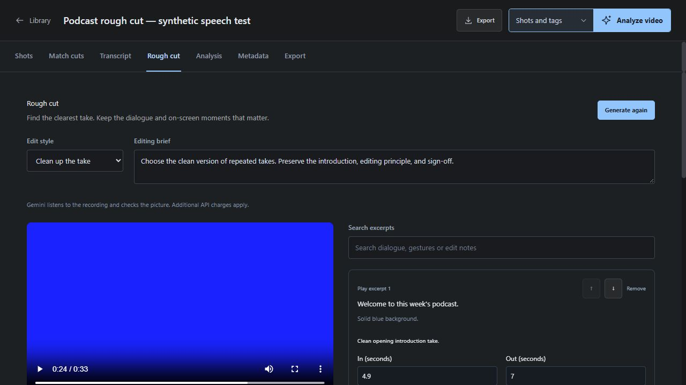

# Video Analyzer

Turn footage into a searchable shot library with Gemini analysis, visual match-cut discovery, editable metadata, and exports for the edit. Built for agency teams finding and reusing footage, and filmmakers exploring their material.


## From import to edit

1. **Import a video as its own project.** Preview and organize local footage without an AI key. Source facts, analysis, tags, notes, collections, and review decisions persist in SQLite across restarts.
2. **Choose Shots and tags or Full analysis.** Gemini describes shots, subjects, actions, colors, camera movement, and audio. Full analysis adds deeper cinematography, editing, narrative notes, and a video summary. Known-duration videos are processed in 30-second sections; shots and midpoint thumbnails appear as sections finish after provider upload processing.
3. **Find and review shots.** Search inside one project, play matching shots, edit human tags and notes, and record review and usage-rights status. Open an analysis section to jump back to its shots.
4. **Explore visual match cuts.** Select a detected shape or trace your own outline, then search for similar silhouettes, framing, and colors across selected projects.
5. **Export the whole video or selected shots.** Download metadata and editorial interchange files, or copy individual in/out times and shot ranges.

Analysis runs in the background while the server is running, including when the browser tab closes. Partial results persist, duplicate runs are rejected, and interrupted runs are identified on restart. Retry is explicit; restarting the server does not automatically resume model calls.

## Podcast and talking-head rough cuts

Open a local recording's **Rough cut** tab to generate an editable sequence with Gemini:

- **Clean up the take** preserves the substance while choosing clearer takes and removing false starts, genuinely redundant explanations, and production chatter.
- **Make it shorter** adds a target duration and an editing brief. Gemini considers dialogue alongside visible demonstrations, gestures, reactions, and distractions.
- Read/search the speech excerpts and edit notes, preview the proposed sequence, adjust in/out points, remove or restore excerpts, and reorder them. Save the review before exporting.
- Download **timeline FCPXML** for Resolve or Final Cut Pro, or **JSON** for the edit list. The sequence references the original recording and retains audio; it does not render a new MP4. Relink the original in the editor.

This is a separate, explicitly requested Gemini pass; previous shot analysis is not required. Two-minute speech windows arrive progressively. The Proxy control applies to rough cuts as well as shot analysis: Auto chooses based on the source, Always uses ten-minute temporary uploads, and Off uploads the original. The draft, speech evidence, selection reasons, and usage-based API cost persist in the library. Cancellation/restart retain discovered speech; retry starts a new draft. It never changes the original recording or overwrites the existing shot/transcript analysis.

AI sentence timing and editorial choices need review. The target length is approximate, and a faithful complete thought may take longer. This is not word-aligned filler removal, automatic multicamera switching, or a polished final edit. Timeline imports remain subject to the supported frame-rate/orientation rules below. [Implementation and test details](docs/PODCAST_ROUGH_CUT.md).



## Search the details you remember

Search shot descriptions, colors, shot types, camera work, transcripts, section analysis, summaries, custom analysis, and human annotations. Results explain whether a match comes from the shot itself or from broader section/video context. Project, tag, review, collection, and rights filters help narrow the library.


Text search uses keywords over saved metadata and highlights matching words in shot details and source excerpts.

## Read and search dialogue

Open a video’s **Transcript** tab to read its saved spoken dialogue beside the player. Search the dialogue to highlight matching words, then click a line to play from that moment. The current timed line is highlighted during playback, and the search stays in place when you switch tabs.

Use **Download SRT** in this tab to export all saved dialogue as subtitles. Search filters the displayed lines; it does not trim the subtitle export. Dialogue appears progressively during analysis. Gemini transcription uses approximate shot-level timing, so review the wording and subtitle timing before delivery.

## Explore visual match cuts

Open **Match cuts** to connect shots through shape, composition, and color. Use the searchable project picker to choose which videos to search by title or filename, and adjust the weight of each matching dimension.


*Detected shapes and composition in an outgoing frame from Half-Life: Live action film.*

- **Detect a shape:** click **Identify shapes**, then select a named object or use **Select detected shape** to click a silhouette or drag a box around it. The box selects an existing detected form.
- **Draw your own silhouette:** choose **Draw outline**, drag around the entire visible subject, and release to close the shape. The matcher uses your traced outline directly, so a selection of a whole person does not snap to a smaller detail such as their armor.
- **Match the framing:** keep **Match position and size too** enabled to favor silhouettes in a similar place and at a similar scale. Turn it off to explore similar forms elsewhere in the frame. Composition compares the main subject, facing direction, framing, and open space; color compares the whole frame.

Adjust both cut points, preview **A → B**, and export the pair's trim ranges and discovered outlines as JSON. Each video's selected frames, search settings, drawn outline, candidates, and incoming cut are remembered across navigation and browser refreshes. Returning reconnects to cached results and live progress without starting additional Gemini analysis.

Local frame indexing publishes saved frames progressively and supports pause/resume. Shape and Composition use billable Gemini frame analysis with cached results; color matching stays local. Candidates update as analysis arrives. Weak silhouettes and incompatible framing are filtered out. Outlines are approximate, so inspect the actual frames. The visual index samples five frames per shot. Motion scoring, learned visual embeddings, and frame-accurate NLE export of adjusted match pairs are future work. See [the workflow, implementation, and limits](docs/VISUAL_MATCH_CUTS.md).

A drawn outline is compared against the candidate silhouettes already identified by Gemini. It does not add object tracking or guarantee that every person or object has been detected.

## Export useful information

The dedicated Export screen supports the whole project or one or more selected shots. Available formats depend on the saved analysis and source timing; unavailable options explain what is missing.


| Format | Handoff |
|---|---|
| JSON | Structured metadata, annotations, analysis, and provenance |
| CSV | UTF-8 shot lists for spreadsheets and production handoffs |
| XMP | Metadata sidecars with timed shot markers |
| SRT | Subtitles from available timed transcript cues |
| EDL | Video-only edit lists with supported source timecode |
| Final Cut Pro XML | Shot sequences referencing the original media |

Exports preserve source coordinates and do not render or package video files. Selections from an older analysis are blocked until refreshed. See [accuracy and export boundaries](#accuracy-and-export-boundaries) for timing, subtitle, and editor compatibility details.

## Run locally

### Installed app and editor previews

A Windows companion installer packages the local engine and browser interface, with a tray menu for opening the app, pairing editors, installing the Resolve integration, and quitting. User data stays in `%LOCALAPPDATA%/VideoAnalyzer`; API keys, databases, and footage are excluded from the installer. Setup can install the required FFmpeg tools separately through WinGet.

Windows installers and integration ZIPs are produced by successful [Windows build workflow runs](https://github.com/ijduncan/video-analyzer/actions/workflows/windows-build.yml). Downloads require signing into GitHub; choose a completed successful run.

The **Premiere Pro 26.3+ UXP panel** loads selected original Project clips without copying them, lets you choose Shots and tags or Full analysis, searches progressive shot/dialogue results, opens source moments, adds undoable source markers, and exports SRT. Saved analysis stays in the companion; panel searches and clip choice persist per Premiere project. Original source files are never deleted by the integration.

The **DaVinci Resolve Studio 20.1+ Workflow Integration preview** connects automatically to the running local app, loads selected original Media Pool clips, analyzes on request, searches shots and dialogue, selects source clips, copies file-relative ranges, exports SRT, and adds guarded source markers to verified constant-rate originals. Select one or multiple analyzed shots to save native subclips, append them to a timeline, or build a selects timeline. Each shot carries its own searchable keywords, description, dialogue, and analysis notes; saved subclips can be dragged from the Media Pool. Original media is referenced without copying. No manual pairing code is needed. Windows native testing covered a verified 24 fps fixture; Apple Silicon installation requires an arm64-compatible bridge from the user's own Resolve SDK and still needs native acceptance. The vendor bridge is excluded from downloads. Exact source-viewer seeking and native marker undo transactions are unavailable. See [the Resolve integration](integrations/resolve/README.md) and [installation/test handoff](docs/RESOLVE_HANDOFF.md).

The **Apple Silicon Mac preview** includes an app/DMG build, menu bar lifecycle, editor integration resources, and explicit FFmpeg/local HTTPS setup. Mac uses `https://localhost:8443` with certificate verification; Windows uses HTTP loopback port 8000. Native Mac builds and downloadable artifacts are provided through successful [GitHub Actions runs](https://github.com/ijduncan/video-analyzer/actions/workflows/macos-build.yml).

See [installation, pairing, and integration scope](integrations/premiere/README.md), [desktop build instructions](packaging/README.md), and [the Apple Silicon Mac handoff](docs/MAC_HANDOFF.md). This is a development preview: GUI/menu-bar behavior, local certificate trust, and native Premiere operations still need acceptance on the user's Mac. Developer ID signing and notarization remain release work.

### From source

Requirements: Python 3.11+, Node.js 20.19+ or 22.12+, and ffmpeg/ffprobe on PATH.

### Windows PowerShell

```powershell
python -m venv .venv
.\.venv\Scripts\python.exe -m pip install -r backend/requirements.txt
npm --prefix frontend ci
npm --prefix frontend run build
.\.venv\Scripts\python.exe -m uvicorn app.main:app --app-dir backend --host 127.0.0.1 --port 8000
```

Open [the local workspace](http://127.0.0.1:8000). The backend serves the built frontend, so one server is enough.

### macOS / Linux

```bash
python3 -m venv .venv
.venv/bin/pip install -r backend/requirements.txt
npm --prefix frontend ci
npm --prefix frontend run build
.venv/bin/python -m uvicorn app.main:app --app-dir backend --host 127.0.0.1 --port 8000
```

For frontend development, run the backend on port 8000 and `npm --prefix frontend run dev` in another terminal. Vite proxies `/api` to the backend.

### Gemini configuration

Create an ignored `.env.local` or `.env` in the repository root (see `.env.example`):

```dotenv
GOOGLE_API_KEY=your-key-here
GEMINI_ANALYSIS_MODEL=gemini-3.8-flash
GEMINI_DEEP_MODEL=gemini-3.8-flash
```

The model defaults were selected from official documentation current in September 2026. They are configurable because availability, pricing and quality change. Verify access and benchmark representative footage before bulk processing. Both presets initially use the same stable model; the full preset performs more analysis passes.

Restart the backend after changing `.env.local` or `.env`. Alternatively use **Workspace settings** to supply a personal key. Browser keys are saved in browser localStorage and transmitted in headers to this application's backend, which calls Google. They are not placed in analysis URLs or saved in the library database. Importing/organizing footage does not send it to Google; starting analysis does.

Both Gemini presets passed a live smoke test with the configured key on a synthetic six-second, two-shot clip. Both identified the two exact on-screen labels and produced no invented transcript for silent footage. This verifies API compatibility; representative agency/filmmaker accuracy and comparative model performance remain unbenchmarked. See `docs/VERIFICATION.md`.

### Docker

```bash
docker compose up --build
```

Open [the Docker workspace](http://localhost:5173). Compose binds to loopback and persists both the library database and media in separate volumes. Run one API worker for this local workspace.

## Storage and processing

**Proxy: Auto / Always / Off** sits beside the analysis controls and is remembered in this browser. Auto uses temporary **10-minute, up-to-720p analysis parts** for measured local sources at least **30 minutes** long, larger than **1 GiB**, encoded in heavy camera formats (including ProRes, DNxHD/HR, CineForm, and RAW), or with an estimated data rate of **50 Mb/s or more**. Always proxies any local video with a measured duration; Off uploads the original without encoding. YouTube URLs bypass local proxying. During encoding, the app displays **Preparing analysis proxy** and the current part number; Run details records the selected mode and decision reason. When proxying, only the first part must be prepared before indexing starts; shots still arrive after each 30-second section. Original film timestamps are restored in code for shot search, dialogue, exports, and editor handoffs. Originals are never modified, and this path creates no additional full-film copy.

Proxy creation requires FFmpeg to decode the source. Recognizing a RAW extension does not add vendor RAW support; undecodable formats require a compatible source or an externally generated viewing copy. No Log-to-Rec.709 transform or proxy-to-original import association is implemented yet. Off can encounter provider format, upload, or context limits.

For proxy runs, full analysis combines saved shot and section evidence into a film-wide summary through bounded editorial notes. Custom briefs use the same evidence, so a trailer brief can ask for visual hooks, character introductions, dialogue quotes, escalating stakes, and suggested moments with shot numbers and original timecodes. These reports inherit any missed observations; they do not generate a finished trailer. Gemini 1.5 Pro is deprecated according to [Google's migration guide](https://github.com/google-gemini/gemini-skills/blob/main/skills/gemini-api-dev/references/migration.md); this workflow keeps the configured current Gemini models.

For a film larger than the browser upload limit below, load the original through the Resolve or Premiere panel. Editor imports reference the local file without copying it into the library. See [long-video processing details](docs/PROGRESSIVE_ANALYSIS.md#long-local-films).

| Item | Default location / behavior |
|---|---|
| App-created video copies, thumbnails, and visual caches | `backend/uploads/` (ignored by Git); original source files stay where you selected them |
| Library and analysis records | `backend/data/library.sqlite3` (ignored by Git) |
| Provider key | `.env.local` / `.env` or optional browser override; never in SQLite |
| Upload limit | 2,000 MiB per file; configurable via `MAX_FILE_SIZE_MB` |
| Analysis concurrency | Two jobs; configurable via `MAX_CONCURRENT_ANALYSES` |
| Google file retention | Short-video references are refreshed from the available local source; temporary long-video uploads are deleted after the run, with cleanup attempted after failure or cancellation too |
| Results | Durable after each processing section; partial shots are searchable and reviewable during analysis. Failed sections retain successful results and report incomplete coverage. |

`DATABASE_PATH` and `UPLOAD_DIR` can override storage locations. Back up the database and app-held media to preserve the workspace, and keep your original source files separately; exports do not package video files. YouTube references support analysis but do not provide local technical metadata or a native preview; import a local video for reliable editorial handoffs.

Imports have independent project IDs and results in the same SQLite database, rather than separate database files. The optional **Project label** metadata field can group related imports for an agency; it does not merge their shot browsers.

Remove one project with its trash button, or use the library checkboxes and **Delete selected** for multiple projects. Confirmation lists the projects before removal. Deletion removes their records and only copies or cache files created by the app; it never deletes your original source files. If Windows blocks an app-owned file, the project still leaves the library and cleanup is queued for automatic retry while the server is running, including after a restart.

## Accuracy and export boundaries

AI scene/shot boundaries are **approximate**. Sampling can miss short edits; decimal timestamps do not imply frame accuracy. Model confidence is an uncalibrated estimate, and visible branding does not establish usage rights. Speech text is model transcription with shot-level timing, not a verified word-aligned transcript. SRT export fails clearly when no actual timed transcript exists; it never turns shot descriptions into subtitles.

Progressive indexing waits for the first upload to become ready. Long local films upload in parts, rather than waiting for the entire film. Shots crossing processing boundaries may be split and are flagged for review. Retry currently reprocesses the run; it does not skip successful sections. See [progressive analysis](docs/PROGRESSIVE_ANALYSIS.md) for behavior and measured latency.

EDL requires verified integer source frame rate and embedded non-drop timecode. FCPXML supports integer and exact common fractional frame rates; when embedded timecode is absent, it explicitly uses the media file's zero origin. Import inspection verifies nominal frame cadence against packet presentation timestamps while retaining the independently measured average rate. Unknown or irregular timing stays unverified. FCPXML needs valid source dimensions and references the original filename relative to the exported XML; put the original beside the XML or relink in the editor. Drop-frame, variable-rate and unsupported source timing are rejected with a reason. Generated structures are tested, but round-trip behavior in installed editors remains unverified.

Selected-shot exports preserve original timestamps and annotations. JSON includes relevant section notes as section-wide context, excluding unrelated whole-video summaries and custom reports. Selected SRT retains complete overlapping transcript cues and their original times; it does not invent word alignment. Selections from an older analysis are blocked until refreshed. Rendering a selected portion into a new video file is future work.

Cost figures use recorded provider token usage and dated pricing where available. Thinking tokens are included; audio/context/cache/pricing differences can make an aggregate estimate incomplete. Unknown models are marked unpriced, not assigned a zero-dollar promise.

This release is a **single-user local workspace**. Shared agency deployment still needs authentication, tenant boundaries, permission checks, object storage, a separate durable worker queue, operational monitoring and audit trails. The research and roadmap specify those changes; do not expose the unauthenticated local API as a public service.

## Verification

```powershell
.\.venv\Scripts\python.exe -m pip install pytest httpx
.\.venv\Scripts\python.exe -m pytest backend/tests tests -q
npm --prefix frontend run build
npm --prefix frontend run lint
```

Tests exercise real ffmpeg import/probe/poster generation and range playback, durable storage, metadata validation, search/review behavior, job recovery, mocked analysis stages, timestamp validation, provenance and export formatting. A source corpus with human ground truth is still needed for model accuracy comparisons.

## Research and implementation decisions

Start with [the research brief](docs/research/README.md), then read:

- [Model landscape and architecture](docs/research/model-landscape.md)
- [Agency and filmmaker workflows / competitor analysis](docs/research/workflows-and-market.md)
- [Product roadmap and release gates](docs/ROADMAP.md)

The research compares Gemini, Twelve Labs, cloud indexers and open models, plus Premiere, Resolve, Final Cut, Frame.io, iconik and axle. It distinguishes vendor claims from verified capabilities and recommendations. No universal model winner is assumed.

## Stack

React 19 / TypeScript / Vite / Zustand; Python / FastAPI / Pydantic; SQLite; Google Gen AI SDK; ffmpeg / ffprobe. API docs are available at `/docs` while the server runs.
